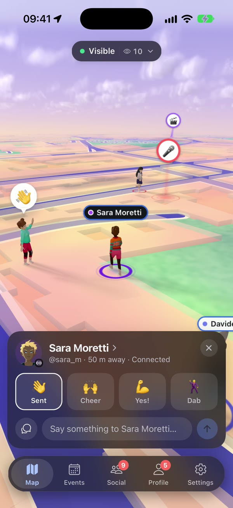
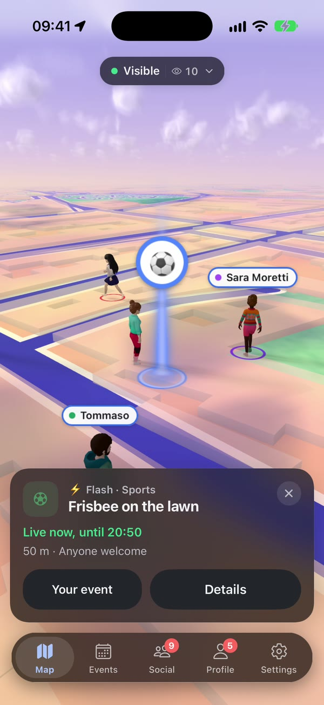
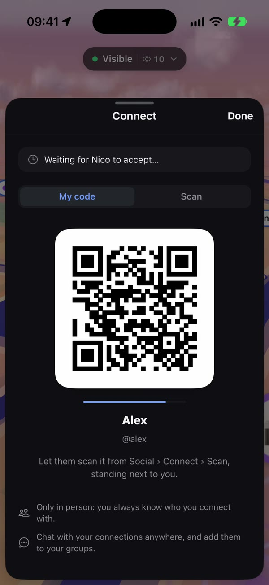
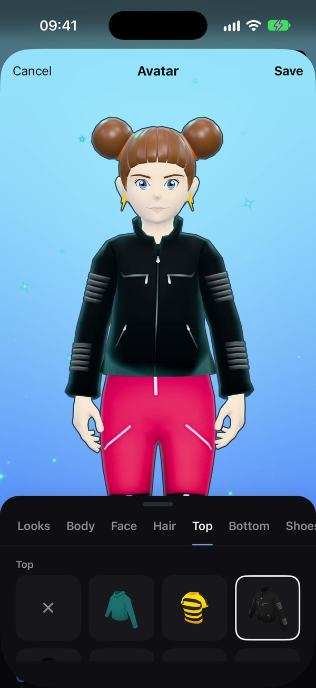

# UnnamedApp

A social map app for meeting people at the events around you, in person. A live 3D map of
your neighbourhood where the people around you walk as their avatars and anyone can pin an
event that everyone nearby sees as a beam of light. iOS and Android, built end to end: the
mobile app, the real-time 3D map and the backend behind them.

**[Showcase](https://lorenzomezza.github.io/social_network/)** ·
**[Try the beta in your browser](https://lorenzomezza.github.io/social_network/demo/)**

  
  
  
  

## What it does

- **Your neighbourhood, live in 3D.** Real streets from OpenStreetMap, at the real hour and in
  the real weather.
- **See who's out, right now.** The people around you walk on the map where they really are.
  Wave, say hi, or say something to everyone nearby. Visible, approximate or invisible: you
  choose each time you open the map.
- **Anyone can put an event on the map.** A flash event with a long press, or a planned one
  with photos and a description. The organizer chooses how far it reaches (100 to 800 m) and
  how it looks.
- **You only see what reaches you,** on the map and in one list.
- **Meet first, connect after.** No search and no friend requests: one phone shows a code,
  the other scans it.
- **The plan before, the photos after.** Chats, groups and polls, and a shared album for every
  event.
- **Show up as you.** A 3D avatar built from hundreds of pieces, and a profile you style.

## How it's built

Three codebases that talk to each other: the mobile app, the 3D map that runs inside it, and
the backend behind both. The map and the avatars rely on no outside provider: there is no map
SDK, tile service or avatar platform underneath, only open data and open-source parts.

| Folder | What it is |
|---|---|
| [`src/`](src) | The mobile app: Expo, React Native, Expo Router |
| [`webview/map/`](webview/map) | The 3D map: three.js inside a WebView, with its own shaders for sky, weather and light |
| [`webview/three-geo-play/`](webview/three-geo-play) | The library that turns vector tiles into the 3D city |
| [`webview/avatar/`](webview/avatar) | The 3D avatar viewer and editor |
| [`backend-java/`](backend-java) | The production backend: Java 25, Spring Boot, PostgreSQL + PostGIS, object storage, push |
| [`backend/`](backend) | The development backend (Python, FastAPI): the reference for how the server behaves |
| [`avatar-server/`](avatar-server), [`asset-pipeline/`](asset-pipeline) | The avatar catalog, files recompressed for each phone's GPU, and each look baked for the map |
| [`tile-provider/`](tile-provider) | Cuts OpenStreetMap data into PMTiles and serves them |
| [`docs/`](docs) | The app-backend contract ([`API.md`](docs/API.md)), the production backend design, promotions, the connection protocol, the art direction |
| [`legal/`](legal) | Privacy policy, terms and third-party notices (drafts) |
| [`show-case/`](show-case) | The showcase site, its videos and the in-browser demo |

Some of the choices, in short:

- **Positions are never stored.** They travel over one WebSocket, live only in the server's
  memory and are dropped a minute after you leave the map.
- **Connections only in person**, with single-use codes that change every few seconds; the
  server checks distance and blocks.
- **A crowd costs a handful of draw calls**: every avatar look is baked once into one mesh and
  one texture atlas.
- **Tests for every part**: the app, the map library, the tile pipeline and both backends
  (`make test`).

## Try it

- **In the browser:** [the beta](https://lorenzomezza.github.io/social_network/demo/) runs the
  real app code with its Python backend compiled to WebAssembly, in your tab. It is a web
  stand-in for a phone app, so expect rough edges.
- **On your computer:** `make dev` sets everything up and starts the servers and Expo (macOS or
  Linux, Node 24+, uv). The full guide, in Italian, is in
  [`docs/DEVELOPMENT.md`](docs/DEVELOPMENT.md).

## Status

A beta: not in the stores yet. What is done in the production backend and what is left:
[`backend-java/STATO.md`](backend-java/STATO.md).

## License

Copyright (c) 2026 Lorenzo Mezzabarba. All rights reserved: see [`LICENSE`](LICENSE). Parts that
come from others (OpenStreetMap data, the Decentraland avatar assets, open-source packages) keep
their own licences.
